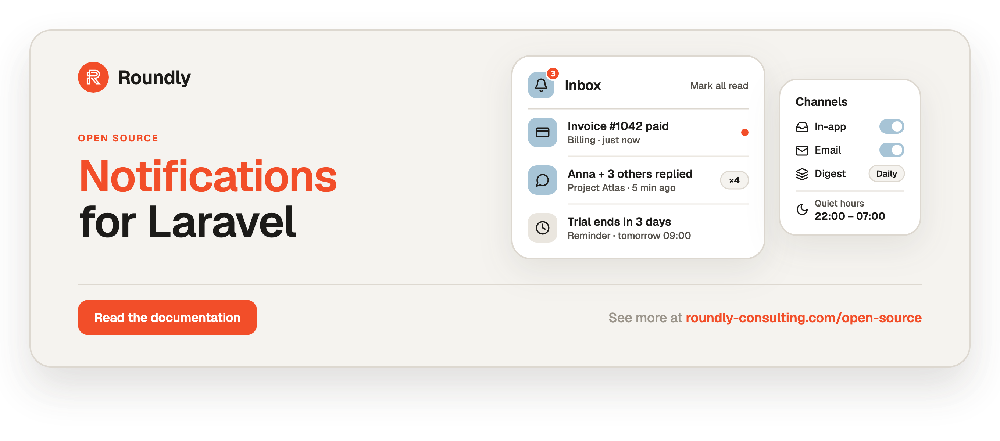

<!-- roundly-hero:start -->
<p align="center">
  <a href="https://roundly-consulting.com/open-source/docs/notifications-for-laravel?utm_source=github&utm_medium=readme&utm_campaign=open-source&utm_content=notifications-for-laravel">
    
  </a>
</p>
<!-- roundly-hero:end -->

<!-- roundly-badges:start -->
<p align="center">
  <a href="https://packagist.org/packages/roundly-consulting/notifications-for-laravel"></a>
  <a href="https://github.com/roundly-consulting/notifications-for-laravel/actions/workflows/run-tests.yml"></a>
  <a href="https://github.com/roundly-consulting/notifications-for-laravel/actions/workflows/fix-php-code-style-issues.yml"></a>
  <a href="https://donate.stripe.com/dRmeVe8FX5PF1Qd9pXcEw00"></a>
  <a href="https://www.patreon.com/cw/roundly"></a>
  <a href="https://roundly-consulting.com/support-us?utm_source=github&utm_medium=readme&utm_campaign=open-source&utm_content=notifications-for-laravel#crypto"></a>
</p>
<!-- roundly-badges:end -->

# Notifications for Laravel

One place to register your app's notification types and deliver them consistently: an in-app
inbox with collapsing and contexts, email with de-duplication, per-user channel preferences,
mandatory types, quiet hours, digests and reminders relative to a date. Features call one API;
delivery, preferences and suppression rules live in the package.

## Installation

Requires PHP 8.4 or newer, Laravel 13, and the `hash`, `mbstring` and `openssl` extensions.

```bash
composer require roundly-consulting/notifications-for-laravel
php artisan vendor:publish --tag="notifications-migrations"
php artisan vendor:publish --tag="options-migrations"
php artisan migrate
```

Held mail, digests and reminders go out from the sweep — schedule it every minute:

```php
Schedule::command('notifications:sweep')->everyMinute()->withoutOverlapping(10)->onOneServer();
```

## Usage

Describe a type once (it needs a `view` policy on its subject, `Company` implementing
`ProvidesNotificationRecipients`, and a `User` with `Notifiable` + `ReceivesNotifications`):

```php
use Illuminate\Database\Eloquent\Model;
use RoundlyConsulting\Notifications\NotificationPayload;
use RoundlyConsulting\Notifications\NotificationType;

// app/Notifications/Types/RequestAwaitingApproval.php — listed in config('notifications.types')
final class RequestAwaitingApproval extends NotificationType
{
    public function key(): string { return 'request.awaiting_approval'; }
    public function category(): string { return 'requests'; }
    public function subject(): ?string { return PurchaseRequest::class; }   // access check: Gate "view" on it
    public function window(): ?string { return 'PT5M'; }                    // 10 events in 5 min → 1 item, 1 mail

    public function title(NotificationPayload $p): string
    {
        return __('app.notifications.awaiting', ['ref' => $p->data['reference'], 'count' => $p->count]);
    }

    public function url(NotificationPayload $p): ?string { return route('requests.show', $p->subjectKey); }
    public function context(?Model $subject): ?Model { return $subject?->company; }   // "Acme s.r.o." label
}
```

Then send it from a feature — inbox, mail, preferences, de-dup, quiet hours and access are applied
for you — and read the user's inbox:

```php
use RoundlyConsulting\Notifications\Facades\Notifications;
use RoundlyConsulting\Notifications\Recipients;

Notifications::send(
    'request.awaiting_approval',
    $request,
    Recipients::role($request->company, 'approver'),
    ['reference' => $request->reference],
    actor: $request->author,
);

$items = Notifications::inbox($user)->unread()->paginate();   // InboxItemResource::collection($items)
Notifications::inbox($user)->unreadCount();                   // 3
Notifications::inbox($user)->markAllRead();
```

<!-- roundly-docs:start -->
## Documentation

The full documentation — configuration, every feature and its API, and testing — lives on our
website: **[roundly-consulting.com/open-source/docs/notifications-for-laravel](https://roundly-consulting.com/open-source/docs/notifications-for-laravel?utm_source=github&utm_medium=readme&utm_campaign=open-source&utm_content=notifications-for-laravel)**

Release notes are in [CHANGELOG.md](CHANGELOG.md). To contribute, see the
[contributing guide](https://github.com/roundly-consulting/.github/blob/main/CONTRIBUTING.md).
<!-- roundly-docs:end -->

<!-- roundly-support:start -->
## Support our work

This package is free and open source, built and maintained by
[Roundly Consulting](https://roundly-consulting.com/open-source?utm_source=github&utm_medium=readme&utm_campaign=open-source&utm_content=notifications-for-laravel).
If it saves you time, please consider supporting our open-source work — a one-time donation, a
monthly pledge on Patreon or a crypto donation helps fund maintenance, new features and new
packages.

<a href="https://donate.stripe.com/dRmeVe8FX5PF1Qd9pXcEw00"></a>
<a href="https://www.patreon.com/cw/roundly"></a>
<a href="https://roundly-consulting.com/support-us?utm_source=github&utm_medium=readme&utm_campaign=open-source&utm_content=notifications-for-laravel#crypto"></a>
<!-- roundly-support:end -->

## License

The MIT License (MIT). See [LICENSE.md](LICENSE.md).
